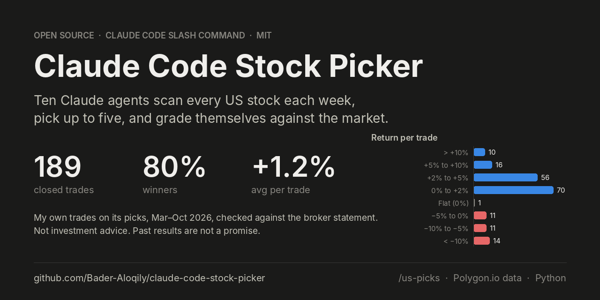
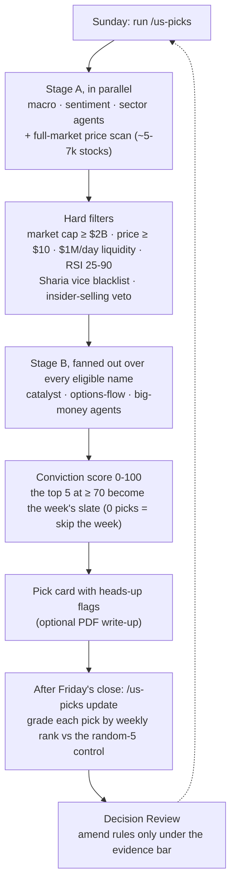

<p align="center">
  <a href="https://github.com/Bader-Aloqily/claude-code-stock-picker">
    
  </a>
</p>

# Claude Code Stock Picker

**An open-source AI stock picker that runs inside [Claude Code](https://www.anthropic.com/claude-code).** Ten specialised Claude agents scan every US stock each week, score the strongest set-ups on a 100-point conviction model, hand you up to five picks on Sunday, and grade themselves on Friday against the whole market and a random control.

[](LICENSE)
[](https://github.com/Bader-Aloqily/claude-code-stock-picker/actions/workflows/lint.yml)


This is the system I run my own money on, as of tag [`v6.3-author`](https://github.com/Bader-Aloqily/claude-code-stock-picker/tree/v6.3-author). The repo ships the complete `/us-picks` slash command, its ten agents and the memory skill, the [Polygon.io](https://polygon.io/) data layer, a drift linter, and the **189 broker-verified trades** I closed on its picks between March and October 2026.

> ⚠️ **Not investment advice.** This is a personal research tool published as open source. It does not tell anyone what to buy, I do not publish picks before the week, and past results do not predict future results. Use at your own risk.

## Table of contents

- [What the picks did in my account](#what-the-picks-did-in-my-account)
- [Why it is different from asking a chatbot for stock tips](#why-it-is-different-from-asking-a-chatbot-for-stock-tips)
- [How it works](#how-it-works)
- [What a pick looks like](#what-a-pick-looks-like)
- [Quick start](#quick-start)
- [Commands](#commands)
- [What it costs to run](#what-it-costs-to-run)
- [Technical details for forkers](#technical-details-for-forkers)
- [Repository layout](#repository-layout)
- [FAQ](#faq)
- [Contributing](#contributing)
- [Disclaimer](#disclaimer)
- [License](#license)

## What the picks did in my account

<picture>
  <source media="(prefers-color-scheme: dark)" srcset="docs/assets/returns-dark.svg">
  
</picture>

> **Version note (2026-10-19).** The public `main` has diverged from the version I run. PR #2 changed how weeks are graded (daylight-saving-aware session hours, gap fills in the trade simulator, a fail-soft control grade). The trade record below was made on the earlier version, tagged [`v6.3-author`](https://github.com/Bader-Aloqily/claude-code-stock-picker/tree/v6.3-author), not on the current `main`.

| | |
|---|---|
| Closed trades | 189 across 134 tickers, 2026-03-24 → 2026-10-08 |
| Winners | 152 of 189 (80.4%) |
| Average return per trade | +1.2% (median +1.65%) |
| Average winner / average loser | +3.9% / −10.3% (152 winners, 36 losers, 1 flat) |
| Profit factor | 1.6 |
| Typical hold | under a day (median 0.7 days; 103 trades held under 24 hours, 92 closed the same US trading day) |
| Best / worst trade | +40.2% / −32.0% |

Every row of [`results/claude-code-stock-trades.csv`](results/claude-code-stock-trades.csv) is a real fill, checked against my broker statement, with returns after buy and sell commissions. Option trades, trades on my own ideas and open positions are excluded. Notes and a table view of the chart are in [`results/README.md`](results/README.md).

**Read this honestly.** Those are *my* exits on the system's picks, mostly same-day and trailing the intraday move. The system grades itself on a much harder, pre-registered bar: a pick WINs only if its Monday-open → Friday-close return ranks in the top 500 of roughly 3,700 liquid US stocks (top 100 is a BIG WIN), measured against a ~13% chance baseline and a seeded random-5 control drawn from the same universe. On that bar the archived record (47 graded picks, versions 4.5 to 5.3) was 15% WIN with the runners-up control at 20%, so the system has **not yet proven an edge on its own yardstick**. The current version is frozen until 12 graded weeks are in, with a pass line fixed in advance. My dated pick history is not included; the public tracker starts empty so that your record is yours.

## Why it is different from asking a chatbot for stock tips

- **It grades itself against chance.** Every win rate the system prints sits next to the ~13% chance baseline and a seeded random-5 control drawn from the same eligible universe, so it can never flatter itself with a high-base-rate metric.
- **It cannot quietly move the goalposts.** The configuration is frozen (rule F1) until the 12th graded week, with a pre-registered pass line: beat the random control's top-500 rate by at least 8 points and clear the chance baseline, or the system gets simplified down to filters plus random selection.
- **It amends itself only with evidence.** Every grading run ends in a recorded Decision Review. A change is wired only if it clears a pre-committed evidence bar (E1–E10), stays inside the remit and touches none of the four constitutional items: the yardstick, the Sharia screen, spending money, and the charter itself. "Not wired" is the default, and every decision is written down before any file changes.
- **It scans the whole market, not a watchlist.** Roughly 5,000 to 7,000 US common stocks go through the price scan; every name that survives the hard filters is fully scored. No index-membership gate, no momentum pre-filter, no cap on how many names get researched.
- **It is all Markdown and Python.** The command, the agents and the scoring rubric are plain text you can read and change. A linter encodes the system's current state as a contract and fails when any of the ~20 coupled files drifts.

## How it works



**Scoring model (100 points):**

| Component | Points | What it measures |
|---|---:|---|
| Catalyst | 40 | Significance (21), timing (16) and confirmation (3) of earnings, filings, M&A, upgrades and policy signals, tagged by magnitude tier |
| Options flow | 18 | Call/put flow, implied move and smart-money positioning from the options chain |
| Volume surge | 16 | Volume versus the 20-day average |
| Risk / liquidity | 15 | Stop usability (7), liquidity (5) and volatility fit (3) |
| Price momentum | 11 | Week and 3-day momentum, MACD |
| Big money | 0 (informational) | Insider trades, 13F changes and buybacks shown as narrative; a heavy insider-selling cluster is a hard drop |

**Grading (the yardstick):**

| Weekly rank, Monday open → Friday close, among ~3,650–3,900 liquid US stocks | Grade |
|---|---|
| ≤ 100 | **BIG WIN** (also counts as a WIN) |
| ≤ 500 | **WIN** |
| 501–1500 | FLAT |
| > 1500, or unranked | LOSS |

Chance baseline: about 13% of picks would land in the top 500 at random, about 2.6% in the top 100. SPY's same-week return, the pick's own close return and the +2% intraweek touch are reported beside the grade as context, never as the grade.

## What a pick looks like

Each run prints a market-regime banner, a heads-up flags table (every risk the run raised, in plain English) and then one card per pick. Abridged template:

```
+---------------------------------------------------------------------+
|   US WEEKLY PICKS — Week of YYYY-MM-DD (v6.3 — land the top 500)    |
+---------------------------------------------------------------------+
|  MARKET CONTEXT                                                     |
|  S&P 500: [level] ([+/-X.X%] this week) — Mood: [BULL/NEUTRAL/BEAR] |
|  Regime: [RISK-ON/NEUTRAL/RISK-OFF] — Advice: [RUN/CAUTION/SKIP]    |
|  10Y: X.XX% | VIX: XX.X | DXY: XXX.X  | Trading days: X of 5        |
|  Key theme: [one-line macro summary]                                |
+---------------------------------------------------------------------+
|  PICK 1: [TICKER] — [COMPANY NAME]                                  |
|  Sector: [Sector] | Mkt cap: $X.XB | Index: S&P500/NDX/none         |
|  Total Conviction Score: XX/100                                     |
|    Volume Surge:       XX/16  (vol X.Xx 20d avg)                    |
|    Price Momentum:     XX/11  (wk +X.X%, 3d +X.X%, MACD)            |
|    Catalyst:           XX/40  (Sig XX/21 | Time XX/16 | Conf XX/3)  |
|    Options Flow:       XX/18  (Bull XX/7 | Impl XX/7 | SM XX/4)     |
|    Risk/Liquidity:     XX/15  (Stop XX/7 | Liq XX/5 | VolFit XX/3)  |
|    Big Money:          informational — native XX/10, NOT in score   |
|  Last Close: $XX.XX (prior-day after-hours close — reference only)  |
|  Normal daily move (ATR): $X.XX (X.X%) — for sizing your own trail  |
|  Big Money: hard-reject filter PASSED. [1-line narrative]           |
|  Sharia: PASS — business-activity screen (not vice-listed).         |
|  RISK: suggested max 2% of capital in this name; the 5 picks        |
|    together are ONE correlated bet — suggested slate total <= 10%.  |
|  Entry & exit: YOURS — the system prescribes no entry, stop, exit.  |
|  Why this can beat the market this week:                            |
|  - Catalyst: ...  - Volume: ...  - Options: ...  - Big Money: ...   |
+---------------------------------------------------------------------+
|  PICK 2 ... PICK 5, then RUNNERS-UP 6-10 with scores and reasons    |
+---------------------------------------------------------------------+
```

The full card format, the flags taxonomy and the optional Arabic PDF report are specified in the command and skill files.

## Quick start

**You need:** macOS or Linux, [Claude Code](https://www.anthropic.com/claude-code), Python 3 with `pip`, and a [Polygon.io](https://polygon.io/) plan that includes **stocks REST + flat files (S3)**. Optional: a [Financial Datasets](https://www.financialdatasets.ai/) key for Form 4 insider data, the Benzinga Analyst Ratings and TMX Corporate Events add-ons on Polygon, and `pandoc` for the education PDFs.

1. **Clone to a side directory**, not straight into `~/.claude/`:

   ```bash
   git clone https://github.com/Bader-Aloqily/claude-code-stock-picker.git ~/us-picks-fork
   ```

2. **Install the Python dependencies:**

   ```bash
   bash ~/us-picks-fork/scripts/ensure-deps-us.sh
   ```

3. **Create the API-key files** (the allowlist `.gitignore` keeps them out of git):

   ```bash
   echo "YOUR_POLYGON_REST_KEY" > ~/.claude/.polygon_key
   cat > ~/.claude/.polygon_flatfiles.json <<'JSON'
   {"access_key_id": "...", "secret_access_key": "...",
    "endpoint": "https://files.polygon.io", "bucket": "flatfiles"}
   JSON
   chmod 600 ~/.claude/.polygon_key ~/.claude/.polygon_flatfiles.json
   ```

4. **Copy the system into `~/.claude/`:** `commands/us-picks.md`, `agents/us-*.md`, `scripts/ensure-deps-us.sh` plus `scripts/uspicks_*.py`, and `skills/us-stocks-memory/`. Start your own tracker from `stocks/us-weekly-tracker.md`. What to copy, what to skip and what to customise is spelled out in [docs/ARCHITECTURE.md → Forking & adapting](docs/ARCHITECTURE.md#forking--adapting).

5. **Smoke-test the data layer:** `python3 ~/.claude/scripts/uspicks_data.py` prints ticker details, a grouped-daily count, an after-hours close, an options chain and flat-file reads.

6. **Run it.** On Sunday, open Claude Code and type `/us-picks`. After Friday's close, `/us-picks update` grades the week.

## Commands

| Command | What it does | When |
|---|---|---|
| `/us-picks` | The weekly pick cycle: up to 5 picks scoring ≥ 70/100, or a skipped week. | Sunday |
| `/us-picks update` | Grades last week's picks by weekly rank, prints the scorecard beside the random-5 control, then runs the Decision Review. | After Friday's close |
| `/us-picks review` | Runs the Decision Review on demand; grades nothing. (`board` still works as a legacy alias.) | Any time |
| `/us-picks lesson "X"` | Wires a lesson *you* dictate into the relevant agent, scoring or command files. | After grading |
| `/us-picks realized TICKER +X% success` | Records your realised result next to the system's grade. | When you exit |
| `/us-picks educate` | Writes a PDF explaining each pick in plain language. | After a pick run |

## What it costs to run

My stack costs **$1,095.99 a month** (October 2026): Polygon Stocks, Options and Indices Advanced with the Benzinga Analyst Ratings and TMX Corporate Events add-ons ($695.99), Financial Datasets ($200) and a Claude subscription ($200).

You do not need all of it. The minimum is a Polygon plan with stocks REST + flat-file access plus your Claude Code subscription; the two Polygon add-ons and Financial Datasets are optional, and without them the system falls back to free sources (openinsider.com, dataroma.com, whalewisdom.com, web search). The line-by-line breakdown and what each feed is used for are in [docs/ARCHITECTURE.md → Cost](docs/ARCHITECTURE.md#cost).

## Technical details for forkers

The short list. Everything below is expanded, with dates and rationale, in [docs/ARCHITECTURE.md](docs/ARCHITECTURE.md) and in the system spec at `skills/us-stocks-memory/references/us-picks-system-spec.md`.

- **State of the system.** Version **6.3** (2026-09-01) restored the v4.7/v4.8 scoring matrix and is frozen under rule F1 until the 12th graded week. After that it amends itself only through the recorded Decision Review whose charter, evidence bar and decision rule live in `skills/us-stocks-memory/references/board-charter.md`.
- **No modelled trade plan (v6.1).** The system prescribes no buy day, limit, stop or exit; entry timing and exits are the trader's own. The pick card shows the prior session's after-hours close as a price reference only.
- **Universe.** Market cap ≥ $2B (the whole-market mid-to-mega pick universe), after-hours price ≥ $10, average daily dollar volume ≥ $1M, RSI 25–90, the single-layer Sharia business-activity vice blacklist, and the Big Money `hard_reject` insider-selling veto. There is no index-membership gate; S&P 500 and Nasdaq-100 membership is shown as context on the card.
- **Price scan.** `scripts/uspicks_price_scan.py` pulls the full ~5–7k US common-stock universe from Polygon grouped-daily data and enriches every cheap-filter survivor with market cap, sector and the after-hours close. It runs directly via Bash, in parallel and resumable, and takes ~10-20 min per pick run.
- **Consistency gate.** `scripts/uspicks_lint.py` (stdlib-only, under a second) encodes the system's current state as a contract: rule states, version labels, scoring weights, agent model policy, the scan runtime claim and the tracker's arithmetic. Run `python3 scripts/uspicks_lint.py` before committing, or install it as a pre-commit hook; `uspicks_lint` also runs in CI on every push. If you change the system on purpose, update the contract in the same edit.
- **Sharia screen.** A six-category business-activity blacklist (defense, gambling, alcohol, tobacco/cannabis, adult, pork) in `skills/us-stocks-memory/references/sharia-blacklist.md`, applied in Phase 3.5. No financial-ratio screen. Empty the file to disable it.

## Repository layout

```
commands/us-picks.md                 the slash command — Phase 0 → 7 pick run, U.1 → U.9 grading + Decision Review
agents/us-*.md                       10 active agents (+1 disabled, kept for history): macro, sentiment, sector,
                                     price, catalyst, options, big money, risk, top gainers, performance grader
skills/us-stocks-memory/             SKILL.md + references: scoring model, Sharia blacklist, flags glossary,
                                     report design, decision charter, system spec (+ history placeholder)
scripts/                             Polygon/Financial Datasets data layer, the four scans, grading, PDF renderer,
                                     controls, audits, and uspicks_lint.py
stocks/                              your tracker (starts empty), archive placeholders, the v4.5 top-100 study
results/                             my 189 closed trades on the system's picks (CSV + notes)
docs/ARCHITECTURE.md                 the detailed reference: every rule, filter, version note and cost line
CONTRIBUTING.md                      how to contribute, what is wanted, what needs evidence first
```

## FAQ

**Does it place trades?** No. It never connects to a broker. It prints a pick card; whether, when and how to trade is entirely yours.

**Do I need paid market data?** Yes. Polygon.io stocks REST + flat files power the universe scan, the after-hours closes, the options chains and the weekly ranking that grades every pick. Financial Datasets and the Polygon add-ons are optional.

**Why is the win rate in `results/` so different from the system's own grade?** Because they measure different things. `results/` is what I did with the picks (short holds, my exits). The system's grade is whether a pick ranked in the top 500 of the whole market over the full week, judged against a random control. See [What the picks did in my account](#what-the-picks-did-in-my-account).

**Is it Sharia-compliant / halal?** It applies a business-activity vice blacklist only, with no financial-ratio screen, and it is not a certified Sharia advisory. Verify any compliance claim independently before acting on it.

**Can I use it for markets outside the US?** The data layer, the universe filters, the NYSE holiday tables and the session times are US-specific. The scoring rubric and the governance (frozen config, random control, Decision Review) are not, so a port means replacing the data layer and the filters, not the method.

**Why only up to five picks, and why skip weeks?** If nothing scores ≥ 70/100 after the hard filters, the week is skipped. Quality over cadence.

**Does it run on Windows?** It is developed on macOS and Linux and untested on Windows; WSL is the likely path.

**How long does a run take?** The price scan alone takes ~10-20 min and the agent stages add to that, so start it with time to spare on Sunday.

## Contributing

Contributions are welcome, and most of the useful ones need neither Claude Code nor a Polygon plan: tests (there are none yet), a stats script for `results/`, packaging, Windows/WSL testing, data-layer robustness, docs. [CONTRIBUTING.md](CONTRIBUTING.md) has the wanted list, the ground rules and the setup. The one thing to know up front: the system's scoring, filters and yardstick are frozen and change only with evidence, while everything around them is open. Bugs and ideas go in [Issues](https://github.com/Bader-Aloqily/claude-code-stock-picker/issues), questions in [Discussions](https://github.com/Bader-Aloqily/claude-code-stock-picker/discussions), and security reports follow [SECURITY.md](SECURITY.md).

## Disclaimer

**This system is not financial advice.** It is my personal research workflow, shared as open source. A score-based system can and does pick stocks that fall. Nothing here guarantees profit, capital preservation or accuracy, and the rank-based win rate in `stocks/us-weekly-tracker.md` and the trades in `results/` are not indicative of future results. The Sharia screen is a business-activity blacklist, not a certified advisory; verify compliance independently. You are solely responsible for your investment decisions. Do your own research.

## License

Released under the [MIT License](LICENSE). Use it, copy it, change it and share it, including commercially, as long as the copyright notice stays with it. Provided as-is, with no warranty of any kind.

---

If this is useful to you, a ⭐ on the repo helps other people find it. Want to help? Start with [CONTRIBUTING.md](CONTRIBUTING.md).
