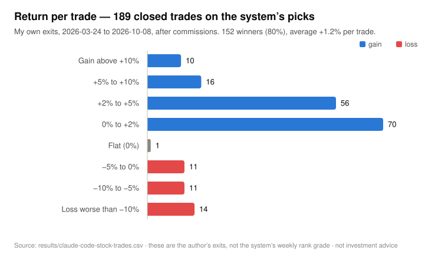

# My trades on the system's picks

`claude-code-stock-trades.csv` lists every **closed stock trade I made on Claude Code's picks**, from 2026-03-24 to 2026-10-08: **189 trades across 134 tickers**.

<picture>
  <source media="(prefers-color-scheme: dark)" srcset="../docs/assets/returns-dark.svg">
  
</picture>

| | |
|---|---|
| Closed trades | 189 (134 tickers), 2026-03-24 → 2026-10-08 |
| Winners | 152 of 189 (80.4%) |
| Average return per trade | +1.2% (median +1.65%) |
| Average winner / average loser | +3.9% / −10.3% (152 winners, 36 losers, 1 flat) |
| Profit factor (gross gains ÷ gross losses) | 1.6 |
| Typical hold | under a day (median 0.7 days; 103 of the 189 held under 24 hours, 92 closed the same US trading day they opened) |
| Best / worst trade | +40.2% / −32.0% |

Table view of the chart

| Return bucket | Trades |
|---|---:|
| Gain above +10% | 10 |
| +5% to +10% | 16 |
| +2% to +5% | 56 |
| 0% to +2% | 70 |
| Flat (0%) | 1 |
| −5% to 0% | 11 |
| −10% to −5% | 11 |
| Loss worse than −10% | 14 |

## How to read the file

- **Returns** are % of the cash in each trade, after buy and sell commissions.
- **Times** are Riyadh time (UTC+3). Each buy and sell time is the order time on my broker statement.
- **Checked against the broker:** every share count, price and commission matches my broker statement for the period.
- **Not included:** option trades, trades on my own ideas, and positions still open.

## What this record is — and isn't

These are **my exits** on the system's picks. I mostly trade the pick on the day the market opens and trail the intraday move, which is why the median hold is under a day and the winners are small and frequent while the losers are rarer and larger.

The system grades *itself* on a different, much harder bar: a pick only WINs if its Monday-open → Friday-close return ranks in the top 500 of roughly 3,700 liquid US stocks, measured against a ~13% chance baseline and a seeded random-5 control. That scorecard lives in [`stocks/us-weekly-tracker.md`](../stocks/us-weekly-tracker.md) (empty in the public release) and is explained in the [README](../README.md#what-the-picks-did-in-my-account). The two records answer different questions; neither predicts the next trade.

Not investment advice. Past results are not a promise.
